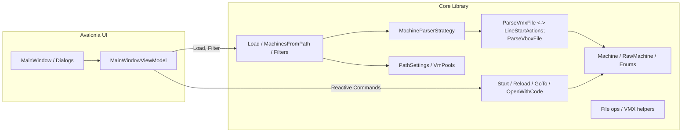
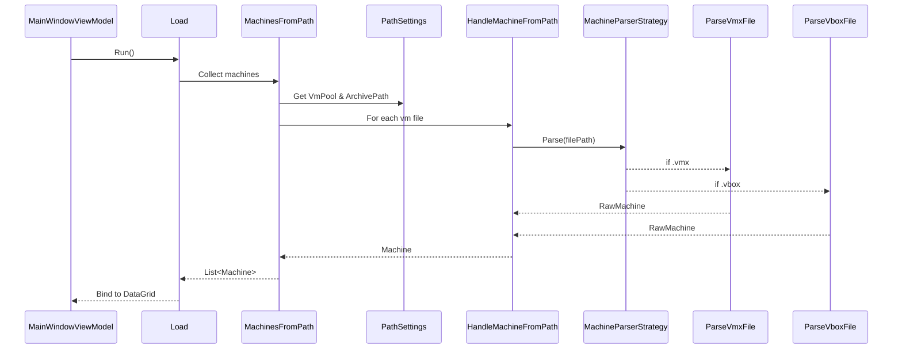

# VmMachineHwVersionUpdater – Solution Documentation

## Overview

VmMachineHwVersionUpdater is a .NET solution that inspects and manages VM configurations for VMware Workstation/Player (.vmx) and VirtualBox (.vbox). It offers a cross-platform UI built with Avalonia and a core library that parses, lists, and updates VM metadata.

Projects:

- VmMachineHwVersionUpdater.Core – domain models, parsing, commands, settings, DI.
- VmMachineHwVersionUpdater.Avalonia – desktop UI, view models, reactive commands, DI wiring.
- Tests – unit tests for Core and Avalonia layers.

## High-level Architecture

## Key Components

### Core Models

- RawMachine: immutable-ish DTO from parsing; fields like DisplayName, HwVersion, MemSize, CpuCount, OSType, VirtualBoxHwVersion, Annotation, etc.
- Machine: UI-bound model with behavior (toggle tools sync, update version/mem) and state (MachineState).
- MachineType, MachineState enums classify VMs and their states.

### Parsing Strategy

- MachineParserStrategy chooses parser by file extension (.vmx/.vbox).
- ParseVmxFile uses IVmxLineStartsWith and ILineStartActions to map line prefixes to property setters in file order. Processing sequentially keeps repeated keys deterministic (the last value in the file wins) and avoids concurrent writes to one RawMachine.
- LineStartActions centralizes the mapping of vmx keys to RawMachine mutations (annotation, guestos, memsize, encryption, etc.).
- ParseVboxFile loads XDocument, navigates VirtualBox namespace, and reads attributes (name, version, OSType) and nodes (Description, Memory, CPU).

### Discovery & Loading

- MachinesFromPath builds a list of VM files (vmx/vbox) from configured pools and archive paths, then handles them via IHandleMachineFromPath to produce Machine instances. Uses filtering via FileListFromPathFilter and can run in parallel. Recoverable per-directory and per-file I/O or parsing failures are traced and do not abort loading other machines.
- Load orchestrates fetching, transforming, and exposing collections for the UI, with filtering helpers (FilterItemSource, GuestOsesInUse, LoadSearchOsItems).

### Periodic Refresh and UI State

- The current application uses the configured `AutoRefreshMinutes` interval (five minutes by default) to poll the VM pools; it does not currently use a `FileSystemWatcher`.
- A refresh builds a fresh machine snapshot on a worker thread. Only after that succeeds does the UI reconcile the snapshot on the UI thread.
- Machines are matched by normalized file path. Existing `Machine` instances and the `DataGridCollectionView` are retained; changed properties are applied in place, new machines are added, and confirmed deletions are removed.
- This keeps the active filter, sort descriptions, selected machine, and collection-view state intact. If a file is temporarily unavailable but still exists, its last successfully loaded row is retained for the next refresh.
- A failed full refresh keeps the current UI snapshot and writes a diagnostic trace. Recoverable per-file failures keep that file's last good row while other machines continue to refresh.

### Commands

- StartCommand, ReloadCommand, GoToCommand, OpenWithCodeCommand, and more—encapsulate user actions triggered from the UI.

### Settings & Configuration

- VmPools.json lists pools and archive paths; placeholders like {UserProfile} are resolved via ReplaceUserProfilePlaceholder and used by PathSettings.
- GuestOsStringMapping.json maps guest OS strings to display-friendly values.

### Dependency Injection

- Core services are registered via ConfigureCoreServices.
- Avalonia adds UI-specific services/VMs via ConfigureAvaloniaServices, ConfigureReactiveCommandServices, and ConfigureWindowsAndViewModels.
- App.axaml.cs wires all DI modules and creates the main window.

## Data Flow (Load to UI)

## Error Handling & Robustness

- Null guards on constructors and methods (ArgumentNullException.ThrowIfNull).
- VMX and VBOX parsing errors are isolated to the affected file during pool discovery.
- Parallel loops use safe collections (e.g., ConcurrentBag) when aggregating.

## Performance Notes

- VM-pool discovery and machine-detail loading still scan configured paths and calculate directory sizes, but periodic scans run off the UI thread.
- MachinesFromPath parallelizes directory and file scanning and traces recoverable path/file failures so one unreadable VM does not cancel the rest of the snapshot.

## Extensibility

- Add new parsers by extending IMachineParserStrategy and implementing IParse… interfaces.
- Add new VMX keys by augmenting LineStartActions.
- New commands follow the existing command interfaces and DI wiring.

## Configuration & Cross-Platform Paths

- Use {UserProfile} placeholder in VmPools.json; resolved via ReplaceUserProfilePlaceholder to Environment.SpecialFolder.UserProfile, supporting Windows/Linux.
- Avoid hard-coded drive letters for Linux; prefer {UserProfile}/vm/… or similar base variables.

## Build & Run

- .NET 9 targeted; publish scripts exist for win-x64/win-arm64.
- UI project is Avalonia; desktop-style application via IClassicDesktopStyleApplicationLifetime.

## Files of Interest

- Core: Strategies/MachineParserStrategy.cs, PerMachine/ParseVmxFile.cs, PerMachine/ParseVboxFile.cs, PerMachine/LineStartActions.cs, BasicApplication/MachinesFromPath.cs, Settings/*.json
- UI: App.axaml(.cs), Views/MainWindow.axaml(.cs), ViewModels/MainWindowViewModel.cs, DI in Avalonia/DependencyInjection/*

## Future Improvements

- Add structured logging (e.g., Serilog) with context for path/file processing.
- Unit tests for ParseVboxFile and MachineParserStrategy edge cases.
- Async I/O for large directory scans; cancellation support from UI.
- Consolidate publish scripts and add CI build steps.

---

Generated automatically; update as architecture evolves.
